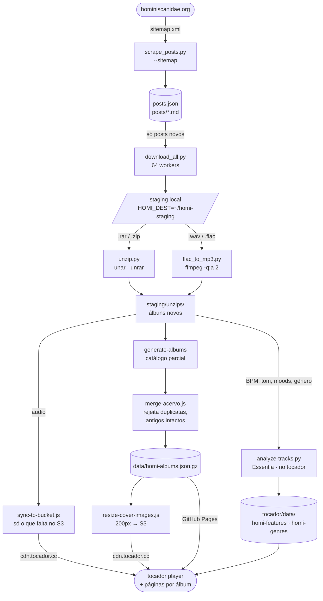

# Hominiscanidae

Arquivo digital do blog **Hominiscanidae** — um dos principais repositórios de música independente brasileira, ativo por mais de uma década com **10.828 posts**. Rock, metal, folk, eletrônico, experimental, indie, samba, MPB e muito mais — totalmente grátis e organizado para explorar.

> **Este repositório é uma instância do [tocador](https://github.com/rafapolo/tocador)**. O código do player, proxy e scripts vivem lá; aqui ficam apenas os dados e a configuração de deploy desta coleção.

## Catálogo

- **6.707 álbuns**, **~5.000 artistas**, ~10.460 horas
- ~66 anos de música independente (1960–2026)
- 10.828 posts arquivados do blog; ~2.930 links mortos (permanentes)

## Como o acervo é montado

Os posts do blog são raspados, os arquivos baixados e descompactados, e tudo é publicado
num catálogo servido direto pelo player do tocador.

Desde outubro de 2026 o acervo não fica mais num disco externo: o áudio existe só no
bucket S3. Cada rodada baixa apenas os posts novos para uma pasta de staging (`HOMI_DEST`,
lida por `download_all.py`, `unzip.py` e `flac_to_mp3.py`), sobe áudio e capas e acrescenta
os álbuns ao catálogo publicado com o `merge-acervo.js` do tocador, que recusa duplicatas e
só grava se nenhum álbum antigo mudar. O catálogo publicado passa a ser a fonte da verdade:
não há mais como regenerá-lo inteiro a partir do áudio. O passo a passo está no `CLAUDE.md`
do tocador (*Adding albums without the music volume*). As páginas por álbum e os sitemaps
são gerados no deploy do tocador.

## Licença e direitos

Mantido para fins educacionais e de preservação cultural. Os direitos pertencem aos respectivos artistas e detentores.

Se você é titular de direitos e deseja que algum conteúdo seja removido, abra uma [issue](https://github.com/rafapolo/hominiscanidae/issues).

---

[Visite o acervo →](https://rafapolo.github.io/hominiscanidae/)
